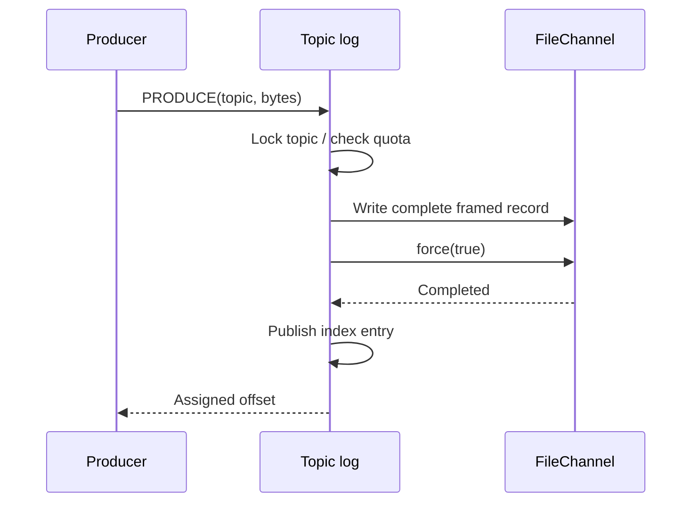

# PulseStream

**A durable, single-node message log with segmented storage and offset-based replay.**

Each topic is one ordered partition. A producer receives an offset only after the full record has been written and `FileChannel.force(true)` returns. Consumers supply their own cursor and can replay any retained offset.

## Storage format

All numeric fields are big-endian:

| Field | Bytes | Meaning |
| --- | ---: | --- |
| Magic | 4 | `0x50554C31` (PUL1) |
| Payload length | 4 | 0..65536 |
| Timestamp | 8 | Producer append wall-clock milliseconds |
| CRC32C | 4 | Checksum of timestamp bytes followed by payload |
| Payload | N | Arbitrary binary bytes |

Files are named by the first logical offset, e.g. `00000000000000000000.log`. Offsets count records, not bytes. An in-memory index maps each offset to its segment and byte position; startup rebuilds it from validated records.

## Commands

| Request | Response |
| --- | --- |
| `PRODUCE topic payload` | Assigned integer offset |
| `CONSUME topic offset [limit]` | `[next_offset, [[offset, timestamp_ms, payload], ...]]` |
| `INFO` | Topic/record/disk-byte counts and durability mode |
| `METRICS` | Transport connections, commands, errors, rejected admissions |
| `PING` | `PONG` |

Consume defaults to 16 records, maximum 16. An offset equal to the log end returns an empty batch and the same cursor. Negative offsets or offsets beyond the end are errors. Unknown topics are errors; PRODUCE creates topics as needed. Names match `[a-zA-Z0-9_-]{1,64}` and are canonicalized to lowercase.

## Recovery policy

1. Scan segments in offset order and validate headers, lengths, CRCs, and contiguous segment bases.
2. Truncate an incomplete header or incomplete body **only in the final segment**, then force the truncation.
3. Refuse startup on checksum mismatch, invalid headers, segment gaps, or an incomplete sealed segment. This avoids silently erasing corruption.
4. Reopen the final segment and continue offsets after the last valid record.

CRC is also checked on reads. A failed append I/O operation marks that topic unavailable until restart/recovery. An OS file lock prevents a second broker using the same data directory.



## Limits and failure semantics

- Default segment size 4 MiB, topic quota 64 MiB, maximum 100,000 records per topic, maximum 16 topics. No retention: reaching quota rejects further writes.
- Topic operations use a ReentrantLock. Same-topic readers and writers serialize; different topics have separate locks.
- There is no replication, consensus, leader election, or consumer group coordination. This implementation runs on one node with one partition per topic.
- A lost response after a successful force leaves an ambiguous outcome. Retrying can duplicate a message; there is no producer idempotency. Clients own persisted consumer cursors.
- `force(true)` is the implemented durability boundary, subject to filesystem/device guarantees. Parent-directory fsync and catastrophic power-loss durability across newly created segment files are not implemented. The automated process-kill test does not simulate a power cut.
- Header length is validated, and timestamp/payload are checksummed. CRC is for accidental corruption, not malicious modification.
- Use a local filesystem; OS file locking and force semantics on network filesystems are outside the tested scope. Data is private to one broker process.
- Removing final complete segments cannot always be distinguished from an earlier valid log without an external manifest; no such manifest exists yet.

## Run and demonstrate

From repository root: `./dev.ps1 build`, then `./dev.ps1 run` on Windows. Defaults: loopback port 9092 and `data/pulsestream`. `python tools/smoke.py` starts a temporary broker, writes records, kills the process, restarts it, and verifies the acknowledged messages and next offset.

Tests additionally cover segment rollover, incomplete tails, CRC damage, quota exhaustion, concurrent producers, and file-lock exclusivity.

## Next experiments

1. Group commit with a bounded queue and explicit acknowledgement latency budget; compare against the current force-per-record baseline.
2. Sparse offset indexing with a documented scan bound, to reduce metadata for long logs.
3. A durable manifest plus filesystem-specific directory syncing, followed by fault-injection testing of rollover.
4. Compare transferTo with copied reads after a stable framing/ownership design exists. Zero-copy is not claimed by this version.

See [design decisions](docs/DESIGN.md) and [recorded measurements](benchmarks/README.md).

## Standalone quick start

This repository builds independently. All application and TCP transport sources are included under `src/`; there are no sibling-project or private Maven dependencies.

Requirements: JDK 21+; Python 3.10+ for optional client and verification tools.

Windows PowerShell:

```powershell
./dev.ps1 build
./dev.ps1 smoke
./dev.ps1 run
```

Linux/macOS (or use `mvnw.cmd` on Windows with JAVA_HOME configured):

```sh
sh ./mvnw verify
python tools/smoke.py
java -jar target/pulsestream-1.0.0.jar
```

In another terminal:

```sh
python tools/client.py --port 9092 PRODUCE orders created
python tools/client.py --port 9092 CONSUME orders 0 16
python tools/client.py --port 9092 METRICS
```

Stop the foreground server with Ctrl+C. The Maven Wrapper downloads Maven on first use. Windows `dev.ps1` finds JDK 21+ in JAVA_HOME, `~/.jdks`, or PATH without changing system Java settings.

## Verification

There are **21 JUnit tests**, including transport framing and connection lifecycle tests. `tools/smoke.py` tests this service through a real TCP connection and verifies acknowledged records after killing and restarting its process.

The GitHub Actions workflow builds and runs smoke tests on Windows/Linux with Java 21/25. Hosted CI results appear after the repository is uploaded and the workflow runs. Local checks used JDK 23.0.2 with Java release 21.

## Repository layout

```text
src/main/java/    Service, storage, bundled transport
src/test/java/    Storage and transport tests
tools/           CLI, smoke test, load generator
docs/            Protocol and engineering decisions
benchmarks/      Measured local baseline and raw JSON
.github/         CI workflow
pom.xml          Independent Maven build
```

Open this folder in VS Code; Ctrl+Shift+B builds the project. See [manual GitHub upload](GITHUB_UPLOAD.md) for publishing this folder as its own repository.
